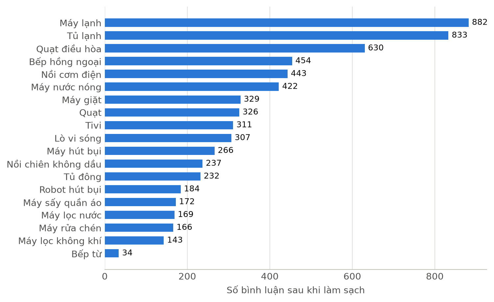
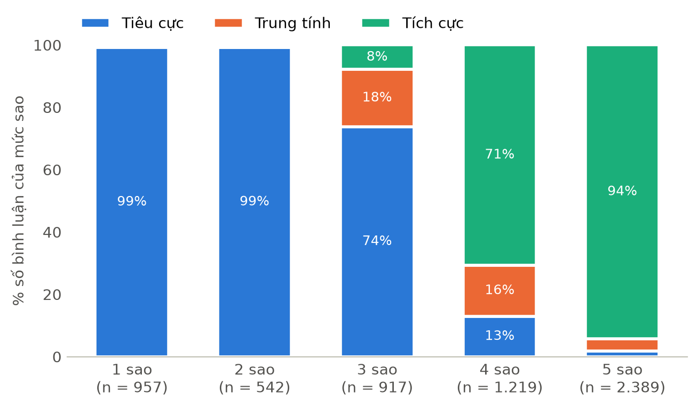
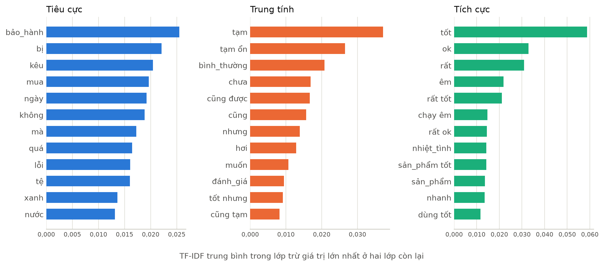
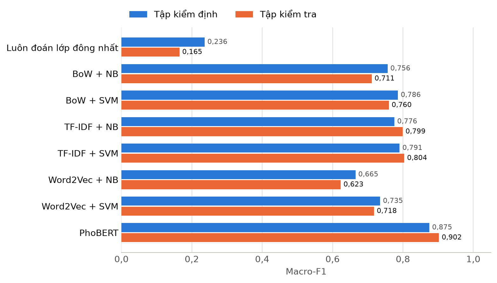
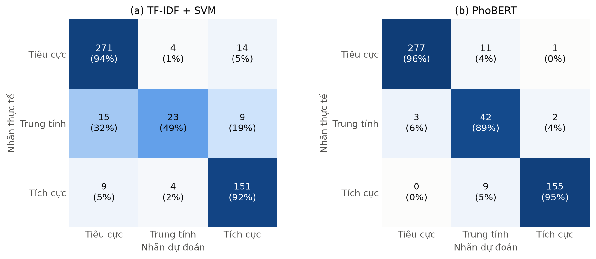

::: {custom-style="CoverSchool"}
HỌC VIỆN CÔNG NGHỆ BƯU CHÍNH VIỄN THÔNG
:::

::: {custom-style="CoverSubject"}
MÔN HỌC: PHÂN TÍCH VÀ KHAI PHÁ DỮ LIỆU VĂN BẢN
:::

::: {custom-style="CoverReport"}
BÁO CÁO BÀI TẬP LỚN
:::

::: {custom-style="CoverTitle"}
PHÂN LOẠI CẢM XÚC BÌNH LUẬN SẢN PHẨM TRÊN ĐIỆN MÁY XANH
:::

::: {custom-style="CoverInfo"}
Giảng viên hướng dẫn: \[\.\.\.\]

Nhóm: \[\.\.\.\]          Lớp: \[\.\.\.\]

Sinh viên thực hiện:

Nguyễn Văn Ngọc San, mã sinh viên: \[\.\.\.\]

\[\.\.\.\], mã sinh viên: \[\.\.\.\]

\[\.\.\.\], mã sinh viên: \[\.\.\.\]
:::

::: {custom-style="CoverDate"}
Hà Nội, tháng 11/2026
:::

# 1. Giới thiệu về bài toán

## 1.1 Bối cảnh

Trên các website bán lẻ, mỗi sản phẩm thường có từ vài chục đến vài trăm bình luận của người mua. Người mua mới đọc chúng để quyết định có nên mua hay không, còn cửa hàng dựa vào chúng để phát hiện sản phẩm hay hỏng hoặc khâu giao hàng, lắp đặt có vấn đề. Khi số bình luận lên tới hàng nghìn, việc đọc thủ công không còn khả thi. Phân loại cảm xúc tự động giúp tổng hợp nhanh mức độ hài lòng theo từng sản phẩm và lọc ra các bình luận phàn nàn cần xử lý.

Điện Máy Xanh (dienmayxanh.com) là chuỗi bán lẻ điện máy lớn ở Việt Nam. Bình luận trên website chủ yếu nói về máy lạnh, tủ lạnh, máy giặt, nồi cơm điện và các đồ gia dụng khác, mỗi bình luận kèm số sao từ 1 đến 5. Số sao có thể dùng làm nhãn, nhưng nhóm nhận thấy nó nhiều khi không khớp với nội dung người mua viết, nên nhãn của bài toán được xác định theo nội dung chữ.

## 1.2 Phát biểu bài toán

Đầu vào là một bình luận tiếng Việt dạng văn bản tự do về một sản phẩm trên dienmayxanh.com. Đầu ra là một trong ba nhãn Tích cực (Positive), Trung tính (Neutral) hoặc Tiêu cực (Negative). Bình luận là Tích cực khi người viết nhìn chung hài lòng với sản phẩm hoặc dịch vụ đi kèm (giao hàng, lắp đặt, bảo hành), Tiêu cực khi người viết chê, báo lỗi hoặc phàn nàn, và Trung tính khi không bày tỏ cảm xúc rõ ràng (hỏi thông tin, chưa dùng) hoặc khen và chê cân bằng nhau. Đây là bài toán phân loại văn bản có giám sát với ba lớp, mỗi bình luận nhận đúng một nhãn.

## 1.3 Khó khăn của bài toán

Bình luận được gõ nhanh trên điện thoại nên có nhiều từ viết tắt và teencode ("ko", "đc", "sp"), câu thiếu dấu, sai chính tả hoặc chỉ có vài chữ. Tiếng Việt viết cách nhau theo âm tiết, trong khi nhiều từ gồm hai, ba âm tiết như "máy giặt", "bảo hành", nên cần tách từ. Một bình luận thường vừa khen vừa chê, ví dụ "máy giặt chạy êm nhưng vắt không khô", và mô hình phải nhận ra ý nào nặng hơn cũng như hiểu được phủ định. Về dữ liệu, số sao không phải lúc nào cũng phản ánh nội dung: nhiều bình luận 3 sao thực chất là lời chê, có bình luận 5 sao lại báo lỗi. Ngoài ra đánh giá trên website phần lớn là 4–5 sao, nên dữ liệu lệch về lớp Tích cực và lớp Trung tính rất ít mẫu.

## 1.4 Mục tiêu, phạm vi và bố cục báo cáo

Nhóm xây dựng đầy đủ quy trình phân loại cảm xúc cho bình luận Điện Máy Xanh: tự thu thập dữ liệu, tiền xử lý văn bản tiếng Việt, rồi so sánh ba cách trích chọn đặc trưng là túi từ (BoW), TF-IDF và Word2Vec với hai thuật toán Naive Bayes (NB) và SVM, tổng cộng sáu cấu hình. Mô hình PhoBERT được bổ sung làm mốc so sánh với một mô hình hiện đại tiền huấn luyện cho tiếng Việt. Các mô hình được đánh giá bằng Accuracy, Precision, Recall, F1 và ma trận nhầm lẫn, chỉ số chính là macro-F1 vì dữ liệu lệch lớp. Bài làm giới hạn ở bình luận trên dienmayxanh.com và phân loại ở mức cả bình luận, không phân tích theo từng khía cạnh.

Mục 2 trình bày cơ sở lý thuyết của các kỹ thuật được dùng. Mục 3 mô tả thực nghiệm theo thứ tự thu thập dữ liệu, làm sạch và gán nhãn, tiền xử lý, trích chọn đặc trưng và huấn luyện, kết quả, phân tích lỗi, cuối cùng là kết luận và hướng phát triển.

# 2. Cơ sở lý thuyết

## 2.1 Quy trình phân loại văn bản

Phân loại văn bản là gán cho mỗi văn bản một nhãn trong tập nhãn cho trước dựa trên nội dung của nó. Quy trình gồm bốn bước: tiền xử lý để làm sạch và chuẩn hóa văn bản; trích chọn đặc trưng để chuyển văn bản thành vector số; xây dựng mô hình bằng cách huấn luyện thuật toán phân loại trên các vector đó; và đánh giá mô hình trên dữ liệu chưa dùng khi huấn luyện. Mọi thành phần học từ dữ liệu, như từ điển của túi từ, trọng số IDF hay mô hình Word2Vec, chỉ được học trên tập huấn luyện rồi mới áp dụng cho các tập còn lại. Nếu học cả trên tập kiểm tra, thông tin của tập này rò rỉ vào mô hình và kết quả bị cao hơn thực tế.

## 2.2 Tiền xử lý văn bản tiếng Việt

Làm sạch văn bản là loại bỏ thẻ HTML, địa chỉ web, email, biểu tượng cảm xúc, ký tự lạ và khoảng trắng thừa, sau đó chuyển về chữ thường. Chuẩn hóa tiếng Việt gồm ba việc. Một chữ có dấu có thể được mã hóa ở dạng dựng sẵn hoặc dạng tổ hợp trong Unicode; hai chuỗi trông giống nhau nhưng máy tính coi là khác nhau, nên cần đưa về một dạng chung (NFC). Vị trí dấu thanh có hai kiểu gõ ("hoà" và "hòa", "thuỷ" và "thủy") cần thống nhất. Ký tự lặp để nhấn mạnh ("tốtttt") được rút về một ký tự.

Chỉnh sửa từ (word correction) đưa các biến thể không chuẩn về dạng chuẩn, với bình luận chủ yếu là viết tắt và teencode như "ko" thành "không", "đc" thành "được". Cách đơn giản và kiểm soát được là dùng từ điển ánh xạ do người làm xây dựng; khi đó cần bỏ ra các từ viết tắt đa nghĩa vì sửa sai còn gây hại hơn không sửa.

Tách từ (tokenization) chia văn bản thành các đơn vị có nghĩa gọi là token. Trong tiếng Việt, khoảng trắng chỉ ngăn cách âm tiết, còn một từ có thể gồm nhiều âm tiết; tách theo khoảng trắng sẽ biến "máy giặt" thành "máy" và "giặt", mất nghĩa của từ ghép. Có hai hướng tách từ: dựa trên từ điển (ví dụ khớp dài nhất, chọn từ dài nhất có trong từ điển khi duyệt từ trái sang phải) và dựa trên học máy, trong đó mô hình học ranh giới từ từ một kho văn bản đã tách sẵn. Underthesea và VnCoreNLP theo hướng thứ hai và nối các âm tiết của một từ bằng dấu gạch dưới, ví dụ "máy_giặt".

Từ dừng (stop words) là các từ xuất hiện rất nhiều nhưng ít giúp phân biệt văn bản, như "là", "và", "của", "thì"; bỏ chúng giúp giảm số chiều và nhiễu. Danh sách từ dừng cần tùy chỉnh theo bài toán. Với phân tích cảm xúc, các từ phủ định ("không", "chưa"), mức độ ("rất", "quá", "hơi") và tương phản ("nhưng", "tuy") thường có trong danh sách từ dừng phổ biến, nhưng lại mang tín hiệu cảm xúc: bỏ "không" thì "không lạnh" thành "lạnh". Vì vậy các từ này phải được giữ lại.

Lấy từ gốc (stemming, lemmatization) cần cho các ngôn ngữ biến hình như tiếng Anh ("running", "ran" về "run"). Tiếng Việt là ngôn ngữ đơn lập, từ không biến đổi hình thái, nên không cần bước này; việc gần với nó nhất là nhận diện từ ghép, đã làm ở bước tách từ.

## 2.3 Trích chọn đặc trưng

### 2.3.1 Túi từ và n-gram

Mô hình túi từ (Bag of Words, BoW) xây dựng từ điển $V$ gồm các từ trong tập huấn luyện và biểu diễn mỗi văn bản bằng một vector $|V|$ chiều, phần tử thứ $j$ là số lần từ thứ $j$ xuất hiện trong văn bản. Cách này đơn giản nhưng bỏ qua thứ tự từ và tạo vector rất thưa. Thêm n-gram, tức các cụm $n$ từ liền nhau, giữ lại một phần thứ tự: với bigram, "không lạnh" và "tốt nhưng" trở thành đặc trưng riêng. Từ điển n-gram lớn nên thường dùng ngưỡng min_df để bỏ các n-gram xuất hiện trong quá ít văn bản.

### 2.3.2 TF-IDF và độ tương tự cosine

TF-IDF đánh giá mức độ quan trọng của từ $t$ đối với văn bản $d$ trong tập $N$ văn bản: một từ quan trọng khi xuất hiện nhiều trong văn bản đó nhưng ít xuất hiện ở các văn bản khác.

$$\text{tfidf}(t,d) = \text{tf}(t,d) \times \text{idf}(t), \qquad \text{idf}(t) = \ln\frac{1 + N}{1 + \text{df}(t)} + 1$$

trong đó $\text{df}(t)$ là số văn bản chứa $t$. Việc cộng 1 ở tử và mẫu tránh chia cho 0, còn số 1 phía ngoài giữ cho từ có mặt ở mọi văn bản vẫn có trọng số khác 0. Thành phần tf có thể là số lần xuất hiện $f_{t,d}$; nhóm dùng dạng logarit $\text{tf}(t,d) = 1 + \ln f_{t,d}$ để một từ lặp nhiều lần không lấn át các từ khác. Mỗi vector văn bản sau đó được chuẩn hóa về độ dài 1 (chuẩn L2).

Độ tương tự cosine giữa hai vector đo góc giữa chúng:

$$\cos(\mathbf{a}, \mathbf{b}) = \frac{\mathbf{a} \cdot \mathbf{b}}{\lVert \mathbf{a} \rVert \, \lVert \mathbf{b} \rVert}$$

Với vector TF-IDF đã chuẩn hóa, cosine bằng tích vô hướng và nằm trong khoảng từ 0 (không chung từ nào) đến 1. Nhóm dùng độ đo này để phát hiện bình luận gần trùng.

### 2.3.3 Word2Vec Skip-gram

Vector từ (word embeddings) biểu diễn mỗi từ bằng một vector số thực dày đặc vài trăm chiều, sao cho các từ có nghĩa gần nhau thì vector gần nhau. Word2Vec học các vector này từ ngữ cảnh, với hai kiến trúc: CBOW dự đoán từ trung tâm từ các từ xung quanh, còn Skip-gram dự đoán các từ xung quanh từ từ trung tâm. Với chuỗi từ $w_1, \dots, w_T$ và cửa sổ $c$, Skip-gram cực đại hóa:

$$\frac{1}{T}\sum_{t=1}^{T}\;\sum_{-c \le j \le c,\, j \ne 0} \log p(w_{t+j} \mid w_t), \qquad p(w_O \mid w_I) = \frac{\exp(\mathbf{u}_{w_O}^{\top}\mathbf{v}_{w_I})}{\sum_{w \in V}\exp(\mathbf{u}_{w}^{\top}\mathbf{v}_{w_I})}$$

trong đó $\mathbf{v}_w$ và $\mathbf{u}_w$ là vector đầu vào và đầu ra của từ $w$. Mẫu số chạy trên cả từ điển nên rất tốn kém; trong thực tế người ta dùng lấy mẫu âm (negative sampling), chỉ cần phân biệt cặp từ thật với vài cặp ghép ngẫu nhiên. Vector $\mathbf{v}_w$ sau huấn luyện là vector của từ, và là vector tĩnh: một từ có cùng một vector trong mọi ngữ cảnh.

### 2.3.4 Vector câu trung bình có trọng số TF-IDF

Bộ phân loại cần một vector cho cả bình luận, nên vector các từ được lấy trung bình có trọng số TF-IDF để từ quan trọng đóng góp nhiều hơn từ phổ biến:

$$\mathbf{s}(D) = \frac{\sum_{w \in D} \text{tfidf}(w, D)\, \mathbf{v}_w}{\sum_{w \in D} \text{tfidf}(w, D)}$$

Từ không có trong từ điển của Word2Vec bị bỏ qua; nếu không còn từ nào thì vector câu là vector 0.

## 2.4 Thuật toán phân loại

### 2.4.1 Naive Bayes

Naive Bayes dựa trên định lý Bayes với giả thiết "ngây thơ" rằng các đặc trưng $x_1, \dots, x_n$ độc lập với nhau khi biết lớp $c$:

$$P(c \mid d) = \frac{P(d \mid c)\, P(c)}{P(d)}, \qquad \hat{y} = \arg\max_{c} \; P(c) \prod_{i=1}^{n} P(x_i \mid c)$$

$P(c)$ là xác suất tiên nghiệm của lớp, $P(c \mid d)$ là xác suất hậu nghiệm; $P(d)$ như nhau với mọi lớp nên bỏ qua khi so sánh. Khi tính toán, người ta lấy logarit để đổi tích thành tổng và tránh tràn số dưới.

Multinomial Naive Bayes coi văn bản là một túi từ sinh ra từ phân phối đa thức riêng của mỗi lớp, với xác suất từ $t$ trong lớp $c$ ước lượng có làm mịn:

$$P(t \mid c) = \frac{N_{c,t} + \alpha}{N_c + \alpha\,|V|}$$

trong đó $N_{c,t}$ là tổng giá trị đặc trưng của $t$ trong các văn bản lớp $c$ (số đếm với BoW, trọng số với TF-IDF) và $N_c = \sum_t N_{c,t}$. Với $\alpha = 1$ đây là làm mịn Laplace; nếu không làm mịn, một từ chưa gặp trong lớp $c$ sẽ làm cả tích bằng 0. $P(c)$ có thể lấy theo tỷ lệ lớp trong tập huấn luyện hoặc cho bằng nhau; cách thứ hai giúp mô hình bớt thiên về lớp đông.

Với đặc trưng liên tục và có thể âm như vector Word2Vec, Gaussian Naive Bayes giả sử mỗi chiều $x_i$ của lớp $c$ có phân phối chuẩn với trung bình $\mu_{c,i}$ và phương sai $\sigma^2_{c,i}$ ước lượng từ tập huấn luyện:

$$P(x_i \mid c) = \frac{1}{\sqrt{2\pi\sigma^2_{c,i}}} \exp\!\left(-\frac{(x_i - \mu_{c,i})^2}{2\sigma^2_{c,i}}\right)$$

### 2.4.2 Máy vector hỗ trợ (SVM)

Với hai lớp, SVM tìm siêu phẳng $\mathbf{w}^{\top}\mathbf{x} + b = 0$ tách hai lớp sao cho lề, tức khoảng cách từ siêu phẳng tới điểm gần nhất của mỗi lớp, là lớn nhất. Các điểm nằm sát lề là vector hỗ trợ. Với nhãn $y_i \in \{-1, +1\}$, lề rộng $2 / \lVert \mathbf{w} \rVert$; vì dữ liệu thực tế hiếm khi tách được hoàn toàn, SVM lề mềm cho phép vi phạm lề qua biến bù $\xi_i \ge 0$:

$$\min_{\mathbf{w}, b, \xi} \; \frac{1}{2}\lVert \mathbf{w} \rVert^2 + C \sum_{i} \xi_i \quad \text{với} \quad y_i(\mathbf{w}^{\top}\mathbf{x}_i + b) \ge 1 - \xi_i$$

Tham số $C$ lớn phạt lỗi nặng, cho lề hẹp và dễ học quá khớp; $C$ nhỏ cho lề rộng, chấp nhận một số lỗi. Khi dữ liệu lệch lớp, có thể đặt $C$ riêng cho mỗi lớp, tỉ lệ nghịch với số mẫu, để lỗi trên lớp hiếm bị phạt nặng hơn. Văn bản biểu diễn bằng BoW hay TF-IDF có số chiều rất lớn và thường tách được khá tốt bằng siêu phẳng, nên SVM tuyến tính là đủ. Với dữ liệu không tách được tuyến tính, SVM dùng hàm nhân để ngầm ánh xạ dữ liệu lên không gian nhiều chiều hơn, phổ biến là hàm nhân RBF:

$$K(\mathbf{x}, \mathbf{x}') = \exp\!\left(-\gamma \lVert \mathbf{x} - \mathbf{x}' \rVert^2\right)$$

SVM vốn là bộ phân loại hai lớp. Cách một-chống-phần-còn-lại (one-vs-rest) huấn luyện $K$ bộ phân loại, mỗi bộ tách một lớp khỏi các lớp khác, rồi chọn lớp có điểm cao nhất; LinearSVC của scikit-learn dùng cách này. Cách một-chống-một (one-vs-one) huấn luyện $K(K-1)/2$ bộ cho từng cặp lớp rồi bỏ phiếu; SVC với hàm nhân RBF dùng cách này. Với ba lớp, cả hai cách đều cần ba bộ phân loại.

## 2.5 PhoBERT

PhoBERT là mô hình ngôn ngữ dựa trên Transformer, tiền huấn luyện riêng cho tiếng Việt. Cơ chế tự chú ý (self-attention) của Transformer tính biểu diễn của mỗi từ từ toàn bộ câu, nên cùng một từ có vector khác nhau tùy ngữ cảnh, khác với BoW, TF-IDF và Word2Vec. Theo cách làm của BERT, mô hình được tiền huấn luyện trên kho văn bản lớn chưa gán nhãn bằng nhiệm vụ che từ (đoán lại các từ bị che), qua đó học kiến thức chung về ngôn ngữ. PhoBERT dùng cấu hình huấn luyện của RoBERTa; bản phobert-base-v2 mà nhóm dùng được tiền huấn luyện trên 20GB văn bản Wikipedia và báo điện tử cùng 120GB văn bản web tiếng Việt (OSCAR-2301). Mô hình làm việc ở mức từ, nên đầu vào cần được tách từ bằng RDRSegmenter của VnCoreNLP. Để phân loại, một lớp phân loại được đặt lên biểu diễn của token đầu câu và toàn bộ mạng được tinh chỉnh (fine-tune) trên dữ liệu có nhãn trong vài epoch với tốc độ học nhỏ.

## 2.6 Đánh giá mô hình

Dữ liệu có nhãn được chia thành ba tập rời nhau: tập huấn luyện để học tham số, tập kiểm định để chọn siêu tham số và so sánh cấu hình, tập kiểm tra chỉ dùng một lần ở cuối để báo cáo kết quả.

Ma trận nhầm lẫn với $K$ lớp là bảng $K \times K$, ô $(i, j)$ đếm số mẫu có nhãn thực tế là lớp $i$ và được dự đoán là lớp $j$. Với lớp $k$: $TP_k$ là số mẫu lớp $k$ đoán đúng, $FP_k$ là số mẫu lớp khác bị đoán thành $k$, $FN_k$ là số mẫu lớp $k$ bị đoán thành lớp khác. Từ đó:

$$\text{Precision}_k = \frac{TP_k}{TP_k + FP_k}, \qquad \text{Recall}_k = \frac{TP_k}{TP_k + FN_k}, \qquad F1_k = \frac{2\,\text{Precision}_k\,\text{Recall}_k}{\text{Precision}_k + \text{Recall}_k}$$

$$\text{Accuracy} = \frac{1}{n}\sum_{k=1}^{K} TP_k, \qquad \text{macro-F1} = \frac{1}{K}\sum_{k=1}^{K} F1_k$$

Precision cho biết trong các mẫu được đoán là lớp $k$ có bao nhiêu mẫu đúng, Recall (độ phủ) cho biết mô hình tìm được bao nhiêu phần mẫu của lớp $k$, F1 là trung bình điều hòa của hai chỉ số, $n$ là tổng số mẫu. Khi dữ liệu lệch lớp, Accuracy dễ gây hiểu nhầm: mô hình luôn đoán lớp đông nhất có Accuracy bằng tỷ lệ lớp đó, trong khi F1 của các lớp khác bằng 0. Macro-F1 lấy trung bình F1 của các lớp với trọng số như nhau nên lớp ít mẫu như Trung tính ảnh hưởng ngang lớp đông; nhóm dùng nó làm chỉ số chính, kể cả khi chọn siêu tham số.

Mức đồng thuận giữa hai bên gán nhãn được đo bằng hệ số kappa của Cohen, $\kappa = (p_o - p_e)/(1 - p_e)$, với $p_o$ là tỷ lệ mẫu hai bên gán giống nhau và $p_e$ là tỷ lệ trùng ngẫu nhiên tính từ phân bố nhãn của mỗi bên; $\kappa = 1$ là đồng thuận hoàn toàn. Vì tập kiểm tra không lớn, nhóm ước lượng khoảng tin cậy của macro-F1 bằng bootstrap: lấy mẫu có hoàn lại từ tập kiểm tra nhiều lần, tính macro-F1 trên từng mẫu và lấy phân vị 2,5% và 97,5%.

# 3. Thực nghiệm và kết quả

## 3.1 Môi trường và công cụ

Bài làm được viết bằng Python. Nhóm dùng Playwright để điều khiển trình duyệt khi thu thập dữ liệu, pandas để xử lý dữ liệu bảng, Underthesea để tách từ cho các mô hình cổ điển, scikit-learn cho BoW, TF-IDF, Naive Bayes, SVM và các chỉ số đánh giá, gensim để huấn luyện Word2Vec, VnCoreNLP (RDRSegmenter) cùng PyTorch và transformers để tinh chỉnh PhoBERT, matplotlib để vẽ biểu đồ. Các mô hình cổ điển chạy trên CPU, PhoBERT được tinh chỉnh trên GPU NVIDIA GeForce RTX 3060 Laptop. Mọi bước có yếu tố ngẫu nhiên đều cố định hạt giống 42 để chạy lại được; riêng PhoBERT được chạy thêm với hai hạt giống khác chỉ để đo độ dao động.

## 3.2 Thu thập dữ liệu

Nhóm không tìm thấy bộ dữ liệu công khai nào ghi rõ nguồn từ Điện Máy Xanh nên tự thu thập. Tệp robots.txt của website cho phép truy cập trang sản phẩm và trang đánh giá; các đường dẫn và ngành hàng bị chặn đều được bỏ qua. Danh sách sản phẩm lấy từ sơ đồ trang (sitemap), sau khi bỏ ngành hàng bị chặn còn 14.841 trang sản phẩm thuộc 195 ngành hàng. Trang đánh giá nạp bình luận bằng JavaScript, nên nhóm dùng Playwright mở trang như trình duyệt thật, bấm bộ lọc số sao và chuyển trang như người dùng. Chương trình chạy một luồng, nghỉ ngẫu nhiên 2–4 giây giữa hai lần tải và lưu lại trang đã tải. Nhóm không lưu họ tên, số điện thoại hay ảnh đại diện của người bình luận; số điện thoại lẫn trong nội dung được che ngay khi thu thập.

Vì bình luận 4–5 sao chiếm đa số và rất ít sản phẩm có điểm trung bình thấp, nhóm chủ động chọn sản phẩm và giới hạn số bình luận theo sao để có đủ bình luận chê. Trong mỗi ngành hàng, nhóm lấy xen kẽ sản phẩm bán chạy nhất và sản phẩm có điểm đánh giá thấp nhất; với mỗi sản phẩm lấy hết bình luận 1–3 sao, tối đa 60 bình luận 4 sao, 100 bình luận 5 sao và không quá 300 bình luận. Kết quả thu được 9.481 bình luận của 72 sản phẩm (45 sản phẩm bán chạy, 27 sản phẩm điểm thấp) thuộc 19 ngành hàng (Hình 3.1). Do giới hạn theo sao, phân bố số sao trong dữ liệu không phản ánh phân bố thật trên website.

{width=11cm}

## 3.3 Làm sạch và gán nhãn

### 3.3.1 Làm sạch dữ liệu

Dữ liệu thô được lọc qua các bước trong Bảng 3.1. Nhiều nhất là các bình luận dưới 3 từ như "tốt", "ok", quá ngắn để mang thông tin. Sau khi bỏ bình luận trùng y hệt, mỗi bình luận được biểu diễn bằng vector TF-IDF và các cặp có độ tương tự cosine lớn hơn 0,9 chỉ được giữ lại một. Có 75 cặp gần trùng mang số sao khác nhau, một dấu hiệu sớm cho thấy số sao không ổn định so với nội dung. Bước này chạy trên toàn bộ dữ liệu trước khi tách tập kiểm tra, nên giữa tập kiểm tra và tập huấn luyện không còn cặp bình luận gần trùng.

: Bảng 3.1. Các bước làm sạch dữ liệu

| Bước | Số bình luận bị loại | Số bình luận còn lại |
|--------------------------------------------------------|---------------------:|---------------------:|
| Dữ liệu thô | | 9.481 |
| Bỏ bình luận rỗng | 17 | 9.464 |
| Bỏ bình luận dưới 3 từ | 1.976 | 7.488 |
| Bỏ bình luận không phải tiếng Việt | 3 | 7.485 |
| Bỏ phản hồi của nhân viên cửa hàng | 0 | 7.485 |
| Bỏ bình luận trùng y hệt | 690 | 6.795 |
| Bỏ bình luận gần trùng (cosine > 0,9) | 255 | 6.540 |

Còn lại 6.540 bình luận, trung vị 13 từ một bình luận: 1.057 bình luận 1 sao, 612 bình luận 2 sao, 1.068 bình luận 3 sao, 1.306 bình luận 4 sao và 2.497 bình luận 5 sao.

### 3.3.2 Gán nhãn

Tập kiểm tra gồm 500 bình luận lấy ngẫu nhiên phân tầng theo số sao (100 bình luận 1 sao, 70 bình luận 2 sao, 150 bình luận 3 sao, 80 bình luận 4 sao, 100 bình luận 5 sao), mỗi sản phẩm không quá 15 bình luận, kết quả gồm 71 sản phẩm. Tỷ lệ sao thấp được đẩy cao để lớp Tiêu cực và Trung tính có đủ mẫu đánh giá.

Nhãn theo số sao (1–2 sao là Tiêu cực, 3 sao là Trung tính, 4–5 sao là Tích cực) nhanh nhưng nhiễu, nên ngay từ đầu nhóm quyết định tập kiểm tra phải được gán theo nội dung chữ. Nhóm viết hướng dẫn gán nhãn gồm định nghĩa ba nhãn, 9 quy tắc cho trường hợp khó (khen chê lẫn lộn thì theo bên nặng hơn, cân bằng thì là Trung tính; hỏi thông tin là Trung tính, hỏi vì gặp sự cố là Tiêu cực; mỉa mai theo nghĩa thật) và 10 ví dụ biên lấy ngoài tập kiểm tra. Việc gán nhãn do một mô hình ngôn ngữ lớn thực hiện theo đúng hướng dẫn này: mô hình chỉ thấy nội dung bình luận, không thấy số sao, xử lý từng lô 50 bình luận và ghi kèm lý do cùng mức độ chắc chắn (cao hoặc thấp). Ở tập kiểm tra, nhóm đánh dấu 191 trường hợp nghi ngờ, gồm các bình luận mà nhãn của mô hình khác nhãn theo số sao hoặc có độ chắc chắn thấp. Thành viên trong nhóm duyệt kỹ từng câu 2 trường hợp và đều giữ nguyên nhãn; 189 trường hợp còn lại nhóm chấp nhận nhãn của mô hình mà không duyệt từng câu. Để đo độ tin cậy, một thành viên gán độc lập 100 bình luận của tập kiểm tra mà không xem nhãn của mô hình: hai bên trùng nhau ở 88% số bình luận, hệ số kappa đạt 0,798.

Trên tập kiểm tra, 31,2% nhãn theo số sao khác nhãn theo nội dung. Mức lệch thấp ở 1 sao (0,0%), 2 sao (2,9%) và 5 sao (4,0%), nhưng lên tới 31,3% ở 4 sao và 83,3% ở 3 sao: trong 150 bình luận 3 sao có 112 bình luận Tiêu cực, chỉ 25 Trung tính và 13 Tích cực. Mô hình học trên nhãn theo số sao vì vậy cho kết quả trên tập kiểm tra thấp hơn hẳn trên tập kiểm định (Bảng 3.7). Nhóm quyết định gán lại nhãn theo nội dung cho cả tập huấn luyện và kiểm định bằng cùng mô hình ngôn ngữ, giữ nguyên văn hướng dẫn. 6.024 bình luận của hai tập này không có người duyệt; mô hình tự đánh giá 886 trường hợp có độ chắc chắn thấp. Hình 3.2 cho kết quả tương tự tập kiểm tra: tính chung 20,9% bình luận đổi nhãn, 3 sao lệch 81,7% (74% là Tiêu cực), 4 sao lệch 29,4%.

{width=12.5cm}

Bảng 3.2 tổng hợp phân bố nhãn (cách chia tập ở mục 3.5). Lớp Trung tính chỉ chiếm 7–9% ở cả ba tập, ít hơn nhiều so với 15,2% nếu theo số sao. Tập kiểm tra có tỷ lệ Tiêu cực cao hơn vì được lấy mẫu với nhiều bình luận sao thấp.

: Bảng 3.2. Phân bố nhãn theo nội dung của ba tập dữ liệu

| Tập dữ liệu | Số bình luận | Tiêu cực | Trung tính | Tích cực |
|------------------------------------|-------------:|----------------:|---------------:|----------------:|
| Tập huấn luyện | 5.120 | 2.024 (39,5%) | 400 (7,8%) | 2.696 (52,7%) |
| Tập kiểm định | 904 | 343 (37,9%) | 65 (7,2%) | 496 (54,9%) |
| Tập kiểm tra | 500 | 289 (57,8%) | 47 (9,4%) | 164 (32,8%) |
| Huấn luyện và kiểm định, theo số sao (đối chiếu) | 6.024 | 24,9% | 15,2% | 59,9% |

## 3.4 Tiền xử lý

Phiên bản văn bản cho BoW, TF-IDF và Word2Vec đi qua các bước theo thứ tự:

1. Làm sạch: bỏ thẻ HTML, địa chỉ web, email, biểu tượng cảm xúc, ký tự lạ; tách dấu câu dính liền chữ.
2. Chuẩn hóa: Unicode NFC, vị trí dấu thanh theo kiểu mới, rút ký tự lặp.
3. Chuyển về chữ thường.
4. Chỉnh sửa từ bằng từ điển 65 mục viết tắt và teencode do nhóm xây dựng ("ko", "k" thành "không"; "đc", "dc" thành "được"; "sp" thành "sản phẩm"; "mn" thành "mọi người"). Từ "kh" cố ý không đưa vào vì có thể là "không" hoặc "khách hàng".
5. Tách từ bằng Underthesea.
6. Bỏ dấu câu, số, ký tự đơn lẻ và từ dừng theo danh sách 111 từ do nhóm soạn; 39 từ trong danh sách giữ lại, chủ yếu là từ phủ định, mức độ và tương phản ("không", "chưa", "rất", "quá", "hơi", "nhưng", "tuy", "bị", "được"…), không bao giờ bị bỏ.

Phiên bản cho PhoBERT chỉ qua làm sạch, chuẩn hóa, chỉnh sửa từ và tách từ, giữ chữ hoa, dấu câu và từ dừng vì PhoBERT được tiền huấn luyện trên văn bản tự nhiên. Các bước đều xử lý từng bình luận độc lập, không học từ dữ liệu, nên áp dụng cho cả ba tập không gây rò rỉ. Trên 6.540 bình luận, từ điển viết tắt sửa 3.745 lượt trong 2.057 bình luận; 23,5% token sau tách từ là từ nhiều âm tiết; bỏ từ dừng loại 22,5% số token, độ dài trung bình giảm từ 19,1 xuống 14,8 token. Bảng 3.3 đưa ra hai ví dụ: "ko", "đc", "mn" được sửa, các từ "không" được giữ, còn "như", "để", "và", "nha" bị bỏ.

: Bảng 3.3. Ví dụ văn bản trước và sau tiền xử lý

| Bình luận gốc | Sau tiền xử lý |
|--------------------------------------------------|--------------------------------------------------|
| Ko đc như kỳ vọng, ko nhớ để hút bụi và lau hết nhà. Còn luẩn quẩn, lơ ngơ. | không được kỳ_vọng không nhớ hút bụi lau hết nhà còn luẩn_quẩn lơ_ngơ |
| Dùng ổn lắm nha mn. Lọc bụi vải tốt, quần áo lúc nào cũng thơm tho. Nhân viên giao hàng thân thiện, nhiệt tình. | dùng ổn lắm mọi người lọc bụi vải tốt quần_áo lúc_nào cũng thơm_tho nhân_viên giao hàng thân_thiện nhiệt_tình |

Để kiểm tra việc giữ từ phủ định và mức độ, nhóm tìm các n-gram đặc trưng của mỗi lớp trên tập huấn luyện, tức các n-gram có TF-IDF trung bình trong lớp cao hơn hẳn giá trị lớn nhất ở hai lớp còn lại (Hình 3.3). Lớp Tiêu cực gắn với từ về sự cố và hậu mãi ("bảo_hành", "bị", "kêu", "lỗi", "tệ"), lớp Trung tính gắn với "tạm", "tạm ổn", "bình_thường" và các cụm tương phản "tốt nhưng", lớp Tích cực gắn với "tốt", "ok", "rất tốt", "chạy êm". Các từ "không", "chưa", "nhưng", "rất", "quá", "bị" đều có mặt, nghĩa là bỏ chúng theo danh sách từ dừng thông thường sẽ làm mất nhiều tín hiệu.

{width=15cm}

## 3.5 Trích chọn đặc trưng và huấn luyện

Sau khi tách 500 bình luận của tập kiểm tra, 6.040 bình luận còn lại được chia ngẫu nhiên phân tầng theo số sao thành tập huấn luyện (85%) và tập kiểm định (15%). Nhóm loại thêm 16 bình luận (14 ở tập huấn luyện, 2 ở tập kiểm định) có văn bản sau tiền xử lý trùng hoàn toàn với một câu của tập kiểm tra, thường là câu ngắn như "hài lòng sản phẩm", còn lại 5.120 và 904 bình luận.

Ba cách trích chọn đặc trưng đều chỉ học trên tập huấn luyện. BoW đếm từ đơn, hoặc từ đơn và bigram. TF-IDF dùng từ đơn và bigram, tf dạng logarit, idf có làm mịn và chuẩn hóa L2. Word2Vec là Skip-gram 200 chiều, cửa sổ 5 từ, bỏ từ xuất hiện dưới 2 lần, huấn luyện 20 vòng trên tập huấn luyện; vector câu là trung bình có trọng số TF-IDF, ở đây dùng TF-IDF từ đơn với tf thô. Với BoW và TF-IDF, nhóm dùng Multinomial Naive Bayes và SVM tuyến tính (LinearSVC); với vector Word2Vec dùng Gaussian Naive Bayes và SVM hàm nhân RBF, vector được chuẩn hóa về trung bình 0, phương sai 1 trước khi đưa vào SVM. Để xử lý lệch lớp, SVM đặt trọng số lớp tỉ lệ nghịch với số mẫu, còn Naive Bayes được thử cả hai cách lấy xác suất tiên nghiệm. Mỗi cấu hình được thử trên một lưới nhỏ, học trên tập huấn luyện và chọn theo macro-F1 trên tập kiểm định (Bảng 3.4). Mốc dưới là mô hình luôn đoán lớp đông nhất của tập huấn luyện (Tích cực).

: Bảng 3.4. Lưới siêu tham số và giá trị được chọn theo macro-F1 trên tập kiểm định

| Cấu hình | Lưới thử | Được chọn |
|----------------|--------------------------------------------------|----------------------------------|
| BoW + NB | n-gram (1,1) hoặc (1,2); min_df ∈ {1, 2}; α ∈ {0,1; 0,3; 0,5; 1,0}; tiên nghiệm theo dữ liệu hoặc bằng nhau | (1,2); min_df = 2; α = 1,0; tiên nghiệm bằng nhau |
| BoW + SVM | n-gram và min_df như trên; C ∈ {0,003; 0,01; 0,03; 0,1; 0,3; 1,0} | (1,2); min_df = 2; C = 0,01 |
| TF-IDF + NB | n-gram (1,2); min_df ∈ {1, 2, 3, 5}; α và tiên nghiệm như BoW + NB | min_df = 2; α = 0,1; tiên nghiệm bằng nhau |
| TF-IDF + SVM | min_df như trên; C như BoW + SVM | min_df = 5; C = 0,1 |
| Word2Vec + NB | hệ số làm mịn phương sai ∈ {10⁻⁹; 10⁻⁶; 10⁻³}; tiên nghiệm như trên | 10⁻⁹; tiên nghiệm theo dữ liệu |
| Word2Vec + SVM | C ∈ {0,1; 0,3; 1; 3; 10}; γ tự động theo phương sai dữ liệu | C = 0,3 |

Với PhoBERT, nhóm tinh chỉnh mô hình vinai/phobert-base-v2 trên văn bản được tách từ lại bằng RDRSegmenter, cắt ở 128 token (chỉ 1,5% bình luận của tập huấn luyện dài hơn). Mô hình được huấn luyện 4 epoch, kích thước lô 16, tốc độ học $2 \cdot 10^{-5}$ với bộ tối ưu AdamW (suy giảm trọng số 0,01), 10% số bước đầu tăng dần tốc độ học rồi giảm tuyến tính. Hàm mất mát là cross-entropy có trọng số lớp $w_k = n / (K \cdot n_k)$, với $n$ là số bình luận của tập huấn luyện, $K = 3$ và $n_k$ là số bình luận lớp $k$, được 0,843 cho Tiêu cực, 4,267 cho Trung tính và 0,633 cho Tích cực. Macro-F1 kiểm định cao nhất ở epoch 2 (0,875) nên mô hình của epoch này được giữ lại. Chạy lại với hai hạt giống khác cho macro-F1 kiểm định tốt nhất là 0,869 và 0,898, trung bình ba lần là 0,881 với độ lệch chuẩn 0,015.

## 3.6 Kết quả

### 3.6.1 Kết quả chung

Bảng 3.5 cho kết quả trên tập kiểm tra kèm macro-F1 trên tập kiểm định; Precision và Recall là giá trị macro. Hình 3.4 so sánh macro-F1 trên hai tập. Mô hình luôn đoán Tích cực chỉ đạt Accuracy 0,328 và macro-F1 0,165, mọi mô hình khác đều vượt xa mốc này.

: Bảng 3.5. Kết quả trên tập kiểm tra (500 bình luận)

| Mô hình | Accuracy | Precision | Recall | Macro-F1 | F1 Trung tính | Macro-F1 kiểm định |
|----------------------|--------------:|--------------:|-----------:|------------:|-------------:|---------------:|
| Luôn đoán lớp đông nhất | 0,328 | 0,109 | 0,333 | 0,165 | 0,000 | 0,236 |
| BoW + NB | 0,852 | 0,752 | 0,703 | 0,711 | 0,366 | 0,756 |
| BoW + SVM | 0,862 | 0,772 | 0,756 | 0,760 | 0,500 | 0,786 |
| TF-IDF + NB | 0,878 | 0,788 | 0,815 | 0,799 | 0,571 | 0,776 |
| TF-IDF + SVM | 0,890 | 0,843 | 0,783 | 0,804 | 0,590 | 0,791 |
| Word2Vec + NB | 0,720 | 0,634 | 0,646 | 0,623 | 0,301 | 0,665 |
| Word2Vec + SVM | 0,812 | 0,709 | 0,748 | 0,718 | 0,425 | 0,735 |
| PhoBERT | 0,948 | 0,883 | 0,932 | 0,902 | 0,771 | 0,875 |

{width=12.5cm}

### 3.6.2 So sánh các phương pháp trích chọn đặc trưng và các thuật toán

: Bảng 3.6. Macro-F1 trên tập kiểm tra theo đặc trưng và thuật toán

| Đặc trưng | Naive Bayes | SVM |
|----------------------|--------------------:|--------------------:|
| BoW | 0,711 | 0,760 |
| TF-IDF | 0,799 | 0,804 |
| Word2Vec | 0,623 | 0,718 |

Bảng 3.6 sắp lại macro-F1 kiểm tra của sáu cấu hình theo đặc trưng và thuật toán. TF-IDF cho kết quả tốt nhất với cả hai thuật toán (0,799 với NB, 0,804 với SVM). So với BoW, TF-IDF giảm trọng số của các từ có mặt ở hầu hết bình luận như "máy", "mua", "dùng", và tf dạng logarit hạn chế ảnh hưởng của từ bị lặp. Word2Vec kém nhất (0,623 và 0,718). Theo nhóm, Word2Vec chỉ được huấn luyện trên 5.120 bình luận ngắn, quá ít để học vector từ tốt, và phép lấy trung bình trộn vector của "không" với "lạnh" làm mất thông tin phủ định, vốn quan trọng với bài toán này.

SVM tốt hơn NB khi dùng BoW (0,760 so với 0,711, dù khoảng tin cậy của hai mô hình vẫn chồng nhau) và tốt hơn rõ rệt khi dùng Word2Vec (0,718 so với 0,623). Với Word2Vec, nhóm cho rằng Gaussian NB bị ảnh hưởng nặng vì các chiều của vector tương quan với nhau, trái với giả thiết độc lập. Với TF-IDF, hai thuật toán chỉ chênh 0,005; khoảng tin cậy của hai mô hình gần như trùng nhau, và khi chấm bằng nhãn của người (mục 3.6.5) TF-IDF + NB (0,770) còn đứng trên TF-IDF + SVM (0,705). Vì vậy nhóm chỉ kết luận TF-IDF là cách trích chọn đặc trưng tốt nhất trong nhóm cổ điển, không khẳng định SVM hơn NB khi dùng TF-IDF. TF-IDF + SVM có macro-F1 kiểm định cao nhất (0,791) nên được chọn làm mô hình cổ điển đại diện ở các phần sau.

PhoBERT đạt macro-F1 0,902 và Accuracy 0,948, cao hơn mô hình cổ điển tốt nhất khoảng 0,1. Khác biệt lớn nhất ở lớp Trung tính, lớp khó nhất với mọi mô hình: F1 là 0,771 với PhoBERT và 0,590 với TF-IDF + SVM. Theo ma trận nhầm lẫn (Hình 3.5), TF-IDF + SVM chỉ nhận đúng 23 trong 47 bình luận Trung tính (Recall 0,489), 15 bình luận bị đoán thành Tiêu cực và 9 thành Tích cực. PhoBERT nhận đúng 42 bình luận (Recall 0,894) nhưng có 11 bình luận Tiêu cực và 9 bình luận Tích cực bị đoán thành Trung tính, nên Precision của lớp này chỉ là 0,677. Với hai lớp còn lại, cả hai mô hình đều đúng trên 90%.

{width=15cm}

Với TF-IDF và PhoBERT, macro-F1 trên tập kiểm tra còn cao hơn trên tập kiểm định. Hai tập có phân bố nhãn khác nhau (Tiêu cực 57,8% so với 37,9%, Trung tính 9,4% so với 7,2%) và tập kiểm tra chỉ có 47 bình luận Trung tính, nên hai con số không so sánh trực tiếp được; nhóm không coi chênh lệch này là dấu hiệu mô hình tổng quát hóa tốt hơn.

### 3.6.3 Có và không bỏ từ dừng

Với cấu hình TF-IDF + SVM, nhóm huấn luyện thêm phiên bản không bỏ từ dừng và chọn lại siêu tham số trên tập kiểm định. Macro-F1 kiểm định gần như không đổi (0,793 khi không bỏ, 0,791 khi bỏ), phù hợp với việc danh sách từ dừng đã giữ lại các từ mang cảm xúc, phần bị bỏ chủ yếu là đại từ và hư từ. Trên tập kiểm tra phiên bản này đạt 0,812, con số chỉ để tham khảo vì không dùng để chọn mô hình.

### 3.6.4 Nhãn theo số sao và nhãn theo nội dung

Bảng 3.7 so sánh việc huấn luyện bằng nhãn theo số sao và nhãn theo nội dung; tập kiểm tra trong cả hai trường hợp đều gán theo nội dung. Với nhãn theo số sao, macro-F1 tụt mạnh từ tập kiểm định (chấm bằng nhãn theo số sao) sang tập kiểm tra, ví dụ PhoBERT từ 0,781 xuống 0,632. Với nhãn theo nội dung, ở ba mô hình trong bảng khoảng tụt này không còn và macro-F1 kiểm tra tăng thêm 0,17–0,27. Hai lần chạy còn khác nhau ở hai điểm nhỏ (từ điển viết tắt được sửa và 16 bình luận trùng với tập kiểm tra bị loại), nhóm không chạy riêng để tách các yếu tố này nên không quy toàn bộ mức tăng cho việc đổi nhãn.

: Bảng 3.7. Macro-F1 khi huấn luyện bằng nhãn theo số sao và nhãn theo nội dung

| Mô hình | Theo số sao: kiểm định | Theo số sao: kiểm tra | Theo nội dung: kiểm định | Theo nội dung: kiểm tra |
|----------------------|------------------:|------------------:|------------------:|------------------:|
| TF-IDF + NB | 0,738 | 0,633 | 0,776 | 0,799 |
| TF-IDF + SVM | 0,723 | 0,626 | 0,791 | 0,804 |
| PhoBERT | 0,781 | 0,632 | 0,875 | 0,902 |

### 3.6.5 Kiểm tra độ tin cậy của kết quả

Nhóm kiểm tra theo hai cách, chỉ dùng lại dự đoán đã có: bootstrap 2.000 lần trên 500 bình luận của tập kiểm tra (mọi mô hình dùng chung các mẫu) để lấy khoảng tin cậy 95% của macro-F1, và chấm lại các mô hình trên 100 bình luận mà một thành viên đã gán độc lập. Dòng cuối của Bảng 3.8 là mốc: nhãn của tập kiểm tra chấm theo nhãn của thành viên.

: Bảng 3.8. Khoảng tin cậy 95% của macro-F1 và kết quả khi chấm bằng nhãn của người

| Mô hình | Macro-F1 kiểm tra | Khoảng tin cậy 95% | Accuracy theo nhãn người | Macro-F1 theo nhãn người |
|--------------------------------|---------------:|--------------------:|---------------:|---------------:|
| BoW + NB | 0,711 | [0,657; 0,761] | 0,800 | 0,642 |
| BoW + SVM | 0,760 | [0,708; 0,809] | 0,760 | 0,631 |
| TF-IDF + NB | 0,799 | [0,751; 0,846] | 0,860 | 0,770 |
| TF-IDF + SVM | 0,804 | [0,751; 0,853] | 0,800 | 0,705 |
| Word2Vec + NB | 0,623 | [0,579; 0,668] | 0,710 | 0,644 |
| Word2Vec + SVM | 0,718 | [0,672; 0,763] | 0,750 | 0,655 |
| PhoBERT | 0,902 | [0,864; 0,935] | 0,890 | 0,850 |
| Nhãn tập kiểm tra so với nhãn người (mốc) | | | 0,880 | 0,818 |

Khoảng tin cậy rộng từ 0,07 đến 0,10, chủ yếu do lớp Trung tính chỉ có 47 bình luận. Khoảng của PhoBERT [0,864; 0,935] không chồng lên khoảng của TF-IDF + SVM [0,751; 0,853], nên khoảng cách giữa PhoBERT và nhóm cổ điển là đáng tin, còn hai mô hình TF-IDF thì không phân biệt được. Macro-F1 theo nhãn người thấp hơn macro-F1 trên tập kiểm tra ở hầu hết mô hình (trừ Word2Vec + NB, từ 0,623 lên 0,644), ví dụ TF-IDF + SVM từ 0,804 xuống 0,705. Hai con số tính trên hai tập khác nhau (100 và 500 bình luận) nên chỉ so sánh được tương đối, nhưng chúng gợi ý rằng một phần điểm số có thể đến từ việc học theo cách gán nhãn của mô hình ngôn ngữ. PhoBERT vẫn đứng đầu (0,850), cao hơn cả mức đồng thuận giữa nhãn tập kiểm tra và nhãn người (0,818), còn thứ tự trong nhóm cổ điển thay đổi. Vì chỉ có 100 bình luận, bảng này là kiểm tra bổ sung chứ không dùng để xếp hạng.

## 3.7 Phân tích lỗi

Nhóm lấy ngẫu nhiên 30 bình luận bị đoán sai, gồm 15 bình luận sai của TF-IDF + SVM và 15 bình luận sai của PhoBERT. Mỗi bình luận được một mô hình ngôn ngữ lớn đọc và đề xuất một nhóm lỗi kèm ghi chú ngắn, chỉ làm một lượt (Bảng 3.9). Có 6 bình luận cả hai mô hình cùng sai.

: Bảng 3.9. Phân nhóm 30 bình luận bị đoán sai

| Nhóm lỗi | TF-IDF + SVM | PhoBERT | Tổng |
|----------------------------------------------------|-------------:|-------------:|-------------:|
| Khen chê lẫn lộn | 7 | 7 | 14 |
| Phủ định | 4 | 0 | 4 |
| Câu cụt, viết tắt, thiếu ngữ cảnh | 1 | 2 | 3 |
| Chê hoặc báo lỗi bị đoán là Tích cực | 2 | 1 | 3 |
| Chê hoặc báo lỗi bị đoán là Trung tính | 0 | 1 | 1 |
| Câu hỏi thông tin | 1 | 0 | 1 |
| Câu hỏi vì gặp sự cố | 0 | 1 | 1 |
| Chưa dùng, ranh giới Trung tính | 0 | 1 | 1 |
| Phàn nàn dịch vụ | 0 | 1 | 1 |
| Nhãn tập kiểm tra còn tranh cãi | 0 | 1 | 1 |

Khen chê lẫn lộn là nhóm lỗi lớn nhất (14 trên 30 bình luận). Câu "Mọi thứ khá ổn trừ cái nồi bên trong, chống dính cực kỳ tệ" có nhãn Tiêu cực vì lời chê cụ thể nặng hơn lời khen chung chung, nhưng PhoBERT đoán Trung tính; TF-IDF + SVM đoán đúng. Ranh giới giữa "cân bằng" và "nghiêng về một bên" vốn khó, chính người gán nhãn cũng có thể không thống nhất ở những câu này.

Lỗi phủ định chỉ gặp ở TF-IDF + SVM. Với câu "Nồi cơm nấu ít hơi lắm, cho nên cơm ăn ko ngon", từ "ngon" kéo mô hình về Tích cực, có thể vì bigram "không ngon" quá hiếm để có trọng số đủ lớn; PhoBERT đoán đúng Tiêu cực. Câu "Khi máy hoạt động âm thanh rất to cứ như máy sấy tóc vậy" chê bằng cách so sánh, không có từ chê quen thuộc, còn "rất" thường đi với lời khen trong tập huấn luyện, nên TF-IDF + SVM đoán Tích cực. Ngược lại, câu cụt "kh ok 5sao ổn" khiến PhoBERT đoán Trung tính, trong khi TF-IDF + SVM dựa vào "ok", "ổn" để đoán đúng Tích cực.

Câu thử "máy giặt chạy êm nhưng vắt không khô" gom các khó khăn trên. TF-IDF + SVM đoán Tích cực vì "êm" là tín hiệu khen mạnh, còn "không" và "khô" đứng riêng không mang nghĩa chê. PhoBERT đoán Tiêu cực với xác suất 0,62, đúng với hướng dẫn vì lỗi vắt không khô là ý chính; tuy vậy, bỏ chữ "giặt" thì PhoBERT chuyển sang Trung tính (0,68), cho thấy dự đoán với câu khen chê lẫn lộn vẫn chưa ổn định.

## 3.8 Kết luận và hướng phát triển

Nhóm đã xây dựng quy trình phân loại cảm xúc cho bình luận Điện Máy Xanh: thu thập 9.481 bình luận, làm sạch còn 6.540, gán nhãn theo nội dung, tiền xử lý tiếng Việt, so sánh sáu cấu hình cổ điển và PhoBERT. Trong nhóm cổ điển, TF-IDF là cách trích chọn đặc trưng tốt nhất với macro-F1 kiểm tra khoảng 0,80 cho cả Naive Bayes và SVM, Word2Vec huấn luyện trên dữ liệu nhỏ cho kết quả thấp nhất. PhoBERT đạt macro-F1 0,902, cao hơn rõ so với các mô hình cổ điển, nhất là ở lớp Trung tính. Thực nghiệm cũng cho thấy số sao là nhãn nhiễu, đặc biệt ở 3 sao.

Kết quả có các hạn chế sau:

- Nhãn của cả ba tập do cùng một mô hình ngôn ngữ lớn gán theo cùng hướng dẫn, nên các mô hình có thể học theo cách gán nhãn của nó và điểm số cao hơn thực tế. Đối trọng hiện có là kappa 0,798 với một thành viên trên 100 bình luận và bảng chấm lại bằng nhãn người. Trong 191 trường hợp nghi ngờ của tập kiểm tra chỉ 2 trường hợp được duyệt từng câu; các bình luận mà nhãn của mô hình trùng nhãn theo số sao không được ai duyệt, nên tỷ lệ lệch 31,2% chỉ là cận dưới; 12 trong 100 bình luận mà thành viên và mô hình gán khác nhau cũng chưa được phân xử.
- Lớp Trung tính trong tập kiểm tra chỉ có 47 bình luận nên các chỉ số dao động nhiều.
- Phân bố nhãn của tập kiểm tra khác tập huấn luyện vì được lấy mẫu theo số sao; mọi sản phẩm của tập kiểm tra đều có bình luận trong tập huấn luyện.
- Dữ liệu chỉ khoảng 6.500 bình luận, ít hơn mức 8.000–10.000 dự kiến.
- Việc chuyển sang nhãn theo nội dung cho tập huấn luyện được quyết định sau khi đã thấy kết quả trên tập kiểm tra. Nhóm giữ nguyên văn hướng dẫn gán nhãn, không gán lại tập kiểm tra và chỉ chọn mô hình trên tập kiểm định, nhưng so sánh hai cách gán nhãn chưa tách riêng được ảnh hưởng của việc sửa từ điển và loại câu trùng.
- Việc phân nhóm lỗi do một mô hình ngôn ngữ lớn đề xuất, chỉ làm một lượt và chưa đo độ đồng thuận.

Về hướng phát triển, cần thu thập thêm dữ liệu và tăng số bình luận được người gán nhãn độc lập, nhất là lớp Trung tính. Với mô hình cổ điển, có thể ghép từ phủ định với từ đứng sau ngay ở bước tiền xử lý ("không ngon" thành một token) để giảm lỗi phủ định. Bài toán cũng có thể mở rộng sang phân tích cảm xúc theo khía cạnh (sản phẩm, giao hàng, lắp đặt, giá), hoặc dùng mô hình chủ đề như LDA, NMF trên các bình luận Tiêu cực để tìm các loại lỗi khách hàng hay phàn nàn.

# Tài liệu tham khảo

::: {custom-style="Bibliography"}
[1] Nguyễn Thị Mai Trang, *Bài giảng Phân tích và khai phá dữ liệu văn bản*. Khoa Công nghệ thông tin 1, Học viện Công nghệ Bưu chính Viễn thông.

[2] C. D. Manning, P. Raghavan, and H. Schütze, *Introduction to Information Retrieval*. Cambridge University Press, 2008.

[3] B. Liu, *Sentiment Analysis and Opinion Mining*. Morgan & Claypool, 2012.

[4] T. Mikolov, K. Chen, G. Corrado, and J. Dean, "Efficient estimation of word representations in vector space," arXiv:1301.3781, 2013.

[5] T. Mikolov, I. Sutskever, K. Chen, G. Corrado, and J. Dean, "Distributed representations of words and phrases and their compositionality," in *Advances in Neural Information Processing Systems 26*, 2013, pp. 3111–3119.

[6] A. McCallum and K. Nigam, "A comparison of event models for naive Bayes text classification," in *AAAI-98 Workshop on Learning for Text Categorization*, 1998, pp. 41–48.

[7] C. Cortes and V. Vapnik, "Support-vector networks," *Machine Learning*, vol. 20, no. 3, pp. 273–297, 1995.

[8] T. Joachims, "Text categorization with support vector machines: Learning with many relevant features," in *Proc. ECML-98*, LNCS 1398, Springer, 1998, pp. 137–142.

[9] J. Devlin, M.-W. Chang, K. Lee, and K. Toutanova, "BERT: Pre-training of deep bidirectional transformers for language understanding," in *Proc. NAACL-HLT 2019*, 2019, pp. 4171–4186.

[10] D. Q. Nguyen and A. T. Nguyen, "PhoBERT: Pre-trained language models for Vietnamese," in *Findings of the Association for Computational Linguistics: EMNLP 2020*, 2020, pp. 1037–1042.

[11] T. Vu, D. Q. Nguyen, D. Q. Nguyen, M. Dras, and M. Johnson, "VnCoreNLP: A Vietnamese natural language processing toolkit," in *Proc. NAACL-HLT 2018: Demonstrations*, 2018, pp. 56–60.

[12] Underthesea: Vietnamese NLP toolkit. [Online]. Available: https://github.com/undertheseanlp/underthesea (truy cập 04/11/2026)

[13] F. Pedregosa *et al.*, "Scikit-learn: Machine learning in Python," *Journal of Machine Learning Research*, vol. 12, pp. 2825–2830, 2011.

[14] R. Řehůřek and P. Sojka, "Software framework for topic modelling with large corpora," in *Proc. LREC 2010 Workshop on New Challenges for NLP Frameworks*, 2010, pp. 45–50.

[15] J. Cohen, "A coefficient of agreement for nominal scales," *Educational and Psychological Measurement*, vol. 20, no. 1, pp. 37–46, 1960.
:::
